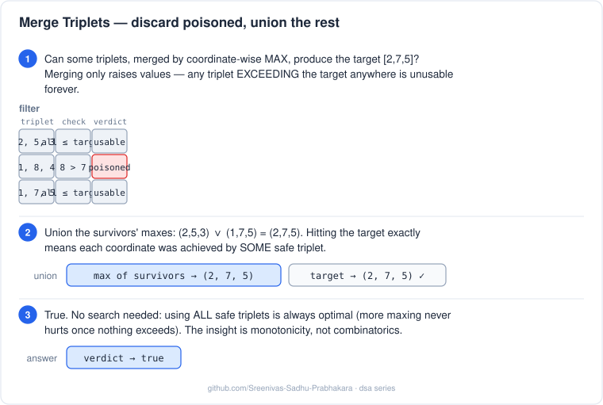

# Merge Triplets to Form Target

> NeetCode 150 · Greedy — max-merging is monotone and irreversible, so: discard any triplet exceeding the target anywhere, then just check the three coordinates are each supplied exactly. Go, stdlib only, tested.

## Problem

Merging two triplets takes the element-wise max. Starting from any chosen subset of the given triplets, can the exact target triplet be assembled?

## Approach

Two observations dissolve the search entirely. First, max never decreases — so a triplet exceeding the target in *any* coordinate is poison forever and can be discarded outright. Second, among the survivors, merging is harmless: every coordinate stays ≤ the target's. So the target is reachable iff each of its three coordinates is hit *exactly* by some surviving triplet — merge all of those and the maxes land precisely on target. The "greedy" here is really a feasibility argument: identify the irreversible operation, filter by it, and the rest is bookkeeping with three booleans.

**Complexity:** O(n) time, O(1) space.

## Visual walkthrough

Read the picture top to bottom — each numbered frame is one moment of the algorithm
running on this repo's test example.

## Run

    go test ./...   # verify
    go run .        # demo

---

Part of a 275-repo DSA series in Go — Striver's SDE Sheet (dsa-001–191) plus the NeetCode 150 / Blind 75 additions (dsa-192–275), stdlib only, every solution tested. Browse: [`dsa-*` repos](https://github.com/Sreenivas-Sadhu-Prabhakara?tab=repositories&q=dsa-&type=source).
